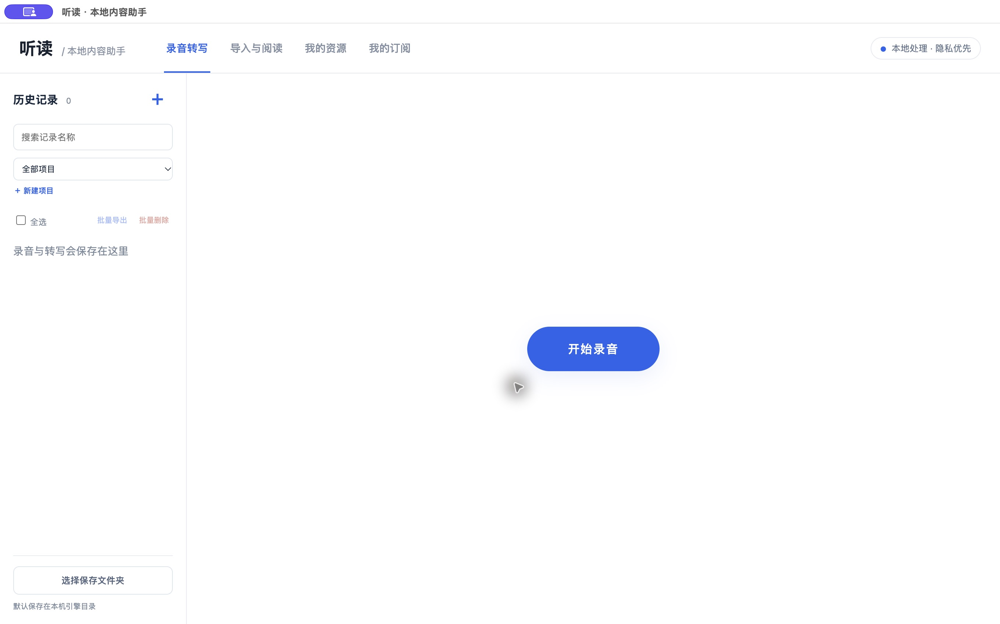

# 听读 · Mac 桌面版

本地录音转写、视频与文章阅读助手。白底蓝色界面，录音和原始文件保存在自己的电脑，使用 SenseVoiceSmall INT8 离线识别中文。

**[下载 Mac 安装包](https://github.com/gwq0514/tingdu/releases)** · [桌面版安装与构建说明](desktop/README.md)

当前桌面版适配 Apple 芯片 Mac（M 系列），内置 Python、FFmpeg、音频模型和轻量总结模型。无需配置开发环境。安装包尚未 Apple 签名和公证；首次打开可能需要在「系统设置 → 隐私与安全」允许。Intel Mac 和 Windows 暂未提供安装包。



- **录音转写**：开始、暂停、继续、结束；逐段原文、发言人临时标记、自由总结及问答。
- **导入与阅读**：B站、小红书、公众号链接，或本地音视频、文字。平台可能限制访问，需要登录的内容不保证能导入。
- **我的资源**：导入内容的封面、标题、摘要及批量导出；录音在自己的历史记录中独立管理。
- **我的订阅**：作者作品分页、多选和批量转写。

默认数据目录：`~/Library/Application Support/听读/data/`。通过「听读 → 打开数据文件夹」查看。源码开发版的数据不自动迁移到桌面版。模型均在本地运行；读取平台链接和下载内容需要联网。实际录音授权需本人操作。

本项目以 GPL-3.0-or-later 开源；模型和第三方组件按各自许可证分发，见 [第三方说明](third_party/desktop-components.json)。发布源码和安装包不包含开发者的录音、资源历史、Cookie 或管理口令。

部署验证：新增 [2 核 2 GiB 完整模型试运行方案](deploy/2gb/README.md)，含录音优先、按需加载、独立进程回收和前端运行状态。当前尚未验证目标服务器上的全功能容量，不影响已发布桌面版。

---

以下是源码开发版的运行说明与实现记录。公开仓库以当前源码快照开始，本机保留的 V1.0 回退标签不受影响。

# 听读：本地内容助手

支持 B站 / 小红书视频链接、公众号正文、音视频文件和文字导入。中文转写与文件存储在本机，摘要问答使用本机 Ollama，不使用付费 API。

## 启动

双击 `start.command`，或在项目目录运行：

```sh
.runtime/bin/python -m uvicorn app:app --host 127.0.0.1 --port 8765
```

打开 http://127.0.0.1:8765 。所有音视频和录音统一使用 SenseVoiceSmall INT8（CPU 单线程）。模型未安装时先运行 `download-model.command`；不会自动下载其他ASR模型。

## 本地总结和问答

本机已配置便携 Ollama 与 `tingdu-qwen`（Qwen3 0.6B Q8，轻量体验模型）。双击启动脚本会同时启动本地模型服务。复杂推理和细节核对能力有限；需要更好的效果时，可下载更大的模型并在页面选择。

安装 Ollama 后可双击 `setup-chat.command`，或运行 `ollama serve`，另一个终端运行 `ollama pull qwen3:1.7b`。刷新网页即可选择模型。所有调用只发往本机 11434 端口。

## 链接获取

- B站：yt-dlp 获取音轨；遇登录限制时，可明确选择读取本机浏览器登录状态。
- 小红书：XHS-Downloader 独立子进程获取视频。保留分享链接内的参数；失败可使用上传入口。图文笔记的图片 OCR 不在本版范围内。
- 公众号：获取 `#js_content` 正文；遇验证页时粘贴正文。嵌入视频不自动解析。
- 仅处理你有权访问和使用的内容，不绕过付费或私密内容的访问权限。

## 数据和限制

数据保存在 `data/`；模型保存在 `data/models/`。没有上传到云端。原文与下载文件可能占用较多磁盘，可在关闭工具后删除相应内容文件夹。

本版分析语音，不分析视频画面；转写可能存在人名、数字或专业词汇错误。问答为独立问题，不保存多轮历史。长正文采用简单片段检索；长内容摘要逐段生成后合并。

## 开源组件

- yt-dlp：https://github.com/yt-dlp/yt-dlp
- SenseVoice：https://github.com/QwenAudio/SenseVoice
- sherpa-onnx：https://github.com/k2-fsa/sherpa-onnx
- FFmpeg：https://ffmpeg.org/
- XHS-Downloader：https://github.com/JoeanAmier/XHS-Downloader （GPL-3.0，第三方代码保留在 vendor，分发或二次开发需按对应许可处理）
- Ollama：https://github.com/ollama/ollama

模型官方下载网络不通时，运行 `./download-model.command small`，从 HF Mirror 下载公开模型文件。下载仅用于首次安装；完成后离线转写。本机已预装 base 和 small 模型，默认使用 small。

验证：`.runtime/bin/python tests.py`。本机使用 Python 3.13；依赖版本见 `requirements.lock.txt`。第三方 XHS-Downloader 版本为 `3261312721f0b37c705ba6515885bc7f34349f2f`。

## 资源库与用户指定目录

“我的资源”是独立页面，包含封面、标题、来源、状态与已有摘要。勾选资源后可批量导出 ZIP，Markdown 或纯文本中包含已有摘要和完整原文。打包由浏览器完成，不将资料传给远端服务。

首次打开会提示选择保存目录。支持 File System Access API 的 Chrome / Edge 可通过“选择保存位置”授权本地目录。每条资源保存为独立文件夹，包含 `record.json`、`原文与摘要.md`、原始媒体（若存在）和封面（若存在）。已有资源可点“保存现有资源”，之后的导入结果与摘要变更会自动同步。浏览器 IndexedDB 只记住目录授权句柄，资源内容保存在用户所选目录中。换浏览器、换站点地址或授权失效时需要重新选择。

重新选择先前的文件夹，可以恢复其中的资源并阅读、导出，即使本地引擎中已经没有对应记录。此类恢复资源若需重新生成摘要，需将原文或媒体重新导入引擎。

浏览器为了隐私只提供目录名称，不提供用户完整磁盘路径。详情页分别显示“所选文件夹/资源子目录”和本地引擎的完整工作目录。未选择目录时，当前版本仍在本机 `data/` 目录保留工作文件；原始文件不会自动删除，便于恢复。没有目录选择能力的浏览器可下载 ZIP，下载位置由浏览器设置或“另存为”决定，不能承诺自动写入指定文件夹。

## 未来开放使用的隐私边界

当前版本仍是本机工具，并未部署成公开网站。要做到“所有人可访问网页，视频和正文不经过服务器”，应采用“公开静态界面 + 每位用户自己的本地引擎 + 浏览器授权目录”的结构。不能把本项目 Python 服务直接部署到公共服务器并称为本地保存：那会使下载、转写和问答在服务器上发生。

本版保留仅允许本机访问的限制。正式支持公开界面连接本地引擎，仍需实现限定站点的配对授权、浏览器本地网络访问兼容、跨平台本地引擎安装与启动；本版未宣称这些已完成。公开服务器不应保存内容、用户目录路径或浏览器登录凭据。

验证：`.runtime/bin/python tests.py`；`node test-export.cjs` 生成 ZIP，可用 Python zipfile 检查中文文件名、完整内容和 CRC。

## 作者订阅与批量生成（开发版）

- 链接导入会记录 B站 / 小红书视频作者；旧资源可在订阅时补充识别。
- 在资源卡片或详情页点击“订阅作者”，进入独立的“我的订阅”页。这是本工具内的订阅，不改变平台上的关注状态。
- 每次展示 10 个视频的封面和标题；“加载更多”继续向后分页，按需读取作品列表，不在后台扫描整个账号。
- 可多选并批量转写和生成摘要；每批最多 30 个，使用同一个本地队列依次处理。
- 已导入或已排队的视频会去重并标记。转写成功但摘要失败时，原文保留，可在详情页重新生成。
- B站使用 yt-dlp 的空间列表能力；小红书匿名状态下尝试公开主页，首屏和后续分页都可能需要用户明确选择本机已登录的浏览器。B站也可能返回 412/429，此时保留缓存并冷却 60 秒。读取失败会提示登录或平台限制，不把失败显示为“没有作品”。只展示平台当前允许访问的视频，不能保证取到私密、删除或被限制的投稿。
- Cookie 只在本机临时读取和使用，不写入订阅配置、不上传到远端。订阅列表与分页缓存保存在本机 data/；选定本地目录后，订阅操作还会保存一份 `订阅信息.json`。
- 当前从用户文件夹恢复、但本地引擎中已不存在的资源，需重新导入其分享链接后才能识别并订阅作者。

验证：`.runtime/bin/python -m unittest tests test_subscriptions`；`node test-export.cjs`；`node test-local-save.cjs`。

V1.0 稳定标签保持不变。本功能在其后的开发提交中实现，未将当前开发版替换为新的稳定回退标签。


## 录音转写（第四个功能页）

启动工具后，顶部依次为「录音转写 / 导入与阅读 / 我的资源 / 我的订阅」，默认进入录音转写。录音转写入口为 http://127.0.0.1:8765/?view=recordings ，旧 /meetings 地址会跳转到此入口。界面沿用白底蓝色，不另建独立网站。录音工作区加载一次后保持在页面内，切换四个功能不会重新创建录音页面；关闭或刷新整个网页会中断录音。

- 点击「开始录音」，由用户允许麦克风；点击「结束并保存」。原声始终保留，转写使用降噪音频。只采集麦克风，不采集电脑内部音频。
- 浏览器使用 AudioWorklet 采集并转成 16kHz 单声道 PCM WAV，约每 4 秒完整提交一个音频片段到本机引擎。片段先保存再排队转写；实际文字延迟取决于 CPU 和其他处理任务。
- 所有ASR固定使用已安装的 SenseVoiceSmall INT8 模型（包括视频、订阅批量转写和完整录音重新转写），复用本地 Ollama 文本模型。未安装模型时不开始录音；文字模型不可用时可选择「仅保存转写」。录音前自动启用本地 GTCRN 降噪，结束后在后台区分发言人。
- 结束后保留原声、时间戳转写及会议结论，支持历史搜索、重命名、回听、时间戳跳转、复制、单份 MD / TXT 导出、历史多选 ZIP 导出和本地问答。
- 录音（包括会议、个人思考等）的内部 source 保持为 meeting，以兼容已有记录，展示名称为录音转写，录音只在「录音转写」历史中管理、筛选和批量导出；「我的资源」只展示导入内容，旧目录里的录音也不会混入。
- 默认文件位于 data/<记录ID>/；chunks/ 中的原始片段会保留，结束后合成 source.wav。选择保存文件夹后，当前查看及当前完成的记录会额外保存原声、原文与摘要.md 和 record.json，由录音历史管理，不在「我的资源」中展示。
- 请保持录音页打开。离开/刷新会提示；刷新前尚未送到本机引擎的音频可能丢失。已接收片段可在历史详情点击「结束这场录音」整理，或在重启后「重新转写」。请求失败会保留本页音频，支持重试保存和 WAV 备份下载；这不是关闭浏览器后的恢复保证。
- 会议录音上限 8 小时；录音有独立的单工作线程队列，与视频共用一个SenseVoiceSmall实例和推理锁。视频每15秒音频窗口之间让出模型，录音优先；已开始的单次推理不会被中断。录音持续提交片段时，视频在后续解码片段前等待，录音结束并处理完已收到音频后恢复；总结排在后台队列。正在执行的单次视频解码或模型请求不会强行中止。浏览器约每秒读取一次转写进度，出字时间仍包含模型推理时间。模型摘要可能失真，待办的负责人/时间未在原文明确时不得推断。
- 仍是本机版本，未对外发布；公开页面与不同用户本地引擎的配对不在本次范围内。

会议专项验证：`python -m unittest test_meetings`、`node test-meeting-audio.cjs`、`node test-meeting-client.cjs`。后者使用模拟设备，不会打开真实麦克风。


### 用户自定义项目

不预设工作、生活等业务分类。未归类的录音以「未分类」显示，这只是空项目状态，不是内置项目。用户按需「新建项目」，录音结束后可修改所属项目，归类是可选步骤，不影响原声和转写的自动保存；项目名称和记录关联仅保存在本机。

历史支持按项目筛选、按项目整组勾选、跨项目多选及清空选择；批量 ZIP 按所属项目建立文件夹，单份 MD / TXT 同样保留原文与已有总结。录音历史展示项目名称，支持按项目筛选，批量 ZIP 按项目分组。更改项目不会移动本机引擎中的原声目录。

录音总结适配会议讨论、日常回忆和个人反思，不能替用户编造未在原文提及的结论或行动。发言人仅按本次录音编号，不识别真实身份。

录音调度测试：`python -m unittest test_recording_priority`，验证独立队列、视频片段间让位、多录音优先级和关闭页面后20秒无新片段的优先租约失效；已接收但尚未处理完的音频仍保持优先。


### 录音页面分步呈现

右侧初始只显示「开始录音」；点击并取得麦克风权限后，显示状态、时长、结束按钮和当前转写原文。结束录音即自动保存，随后才显示可选归类、回听、复制导出、总结和问答。左侧历史列表保留，点击历史直接进入详情，「＋」回到新录音入口。未归类的录音不会丢失或等待分类才保存。切换顶部功能仍保留录音工作区。


## 开源降噪与发言人标注

- 实时前处理：GTCRN（16kHz、单线程 CPU、约0.5MB），4秒片段转写前增强，使用前一片段末尾0.5秒作上下文；输出与原声保持相同样本数，保留时间轴。降噪失败时使用原声转写并提示回退。
- 录音结束：pyannote segmentation 3.0 int8 + 3D-Speaker ERes2Net（模型合计约41MB），由 sherpa-onnx 1.13.8 CPU 执行。按首次发言顺序显示「发言人1、2…」，尽量按 SenseVoice token时间戳对齐；多人重叠或未确定的片段明确标注，不伪造身份或独立音轨。
- 降噪和发言人区分是两种能力：GTCRN主要抑制环境噪声，无法保证去除旁人讲话；发言人分组也不能完整分离同时讲话。实际嘈杂场景仍需核对原声。
- 默认对新录音生效。已有记录点击「重新处理」才会重新转写和标注，不自动改写历史。详情设置可关闭降噪或发言人处理后重新处理。原声和降噪版可以切换回听；复制、MD、TXT、ZIP及问答均带发言人标注。
- 原声 source.wav 与降噪 enhanced.wav 分开保存；选择的本地目录也会保存两份。发言人仅在本次录音中编号，不保存跨录音个人声纹库。后台标注按录音优先级在新录音时让出计算。
- 新环境安装：先安装 requirements.txt，再运行 `.runtime/bin/python scripts/install_audio_models.py`。模型来自项目方公开发布，固定 SHA-256 校验；推理过程中不自动下载，不上传用户音频。来源与许可证见 third_party/audio-models/README.md。
- 当前仍是本机引擎。模型选型面向笔记本CPU并有移动端运行方案；本项目没有实现手机浏览器中的独立 ASR/降噪/发言人推理，也没有实现手机网页与个人引擎的安全配对，不能直接宣称手机端已经可独立运行。
- 模型专项测试：`python -m unittest test_audio_processing`。真实模型验证使用本机合成语音和 sherpa-onnx 官方四人中文样例；这不是对实际嘈杂会议准确率的保证。

### 录音转写：SenseVoice 试用版（2026-10-27）

- 视频导入、文件上传、订阅批量处理、新录音与录音的“重新处理”统一为 SenseVoiceSmall INT8（sherpa-onnx，中文、CPU 单线程），共用一个模型实例；历史资源不自动改写。
- 安装：`.runtime/bin/python scripts/install_sensevoice.py`，模型约228 MiB。模型及分词表由发布者官方导出下载、校验后写入 `data/models/sensevoice/`。
- 继续每约4秒提交录音片段，SenseVoice 为分段离线识别，并非原生流式识别。完整录音重新处理按15秒窗口执行；切片边界仍可能影响识别。
- 使用实际CTC token时间戳；数字/标点归一化导致文本无法与token逐项匹配时保留片段时间，不伪造逐词对齐。发言人区分继续使用原声，重叠讲话与片段级归属可能不准确。
- 当前试用仍在本机运行，并未部署阿里云。此前讨论的云端方案（目前已暂缓）为：模型全部在服务器，录音、原文件与历史记录最终保存在浏览器所在设备；允许上传参与推理，服务器临时文件需清理。现有本机工作文件机制尚未改造成该部署形态。

### 管理员专有词纠正入口

- 当前 SenseVoice + sherpa-onnx CTC 不支持原生热词加权；此功能是**识别后的显式文本纠正**，不会改变声学识别，不会凭单个正确词自动猜测同音词。
- 独立启动：`.runtime/bin/python admin_vocabulary.py`，固定绑定 `127.0.0.1:8767`，访问 http://127.0.0.1:8767/ 。普通内容服务没有管理路由，也不提供管理静态文件。
- 首次启动生成 `data/admin/管理口令.txt`（仅本机文件、权限0600），将其中口令粘贴到管理登录框。口令只留在当前标签页内存，不写URL、浏览器存储或访问日志。退出/刷新后重新登录。口令和词库均被Git忽略。
- 每行格式：`正确词语 | 常见误识别写法 | 其他误识别写法`。例如 `听读 | 听堵 | 听独`。误识别写法至少2字，不能同时映射到多个正确词；长词优先、单次替换，英文词有边界限制。不要配置容易误改正常语句的常用词。
- 支持整体启停、批量编辑、版本冲突检测和已保存规则的文字预览。保存后下一次SenseVoice推理热加载，不重载模型。适用于所有新音视频与录音转写。不会自动更新历史记录；重新处理录音后重新生成总结。词语跨音频片段边界时可能无法命中。
- 纠正前的ASR文字与时间戳保留于工作记录的 `raw_asr_text`/`asr_segments`，原声保持不变；纠正词沿用原token覆盖的时间范围，不伪造更精细的对齐。
- 管理服务有口令认证、来源/Host/本机连接校验、请求大小限制和禁止缓存。**未来云端不要反向代理或公开8767端口**；用SSH本地隧道管理。生产用户权限体系仍未实现，不能把当前内容服务当作多用户公网后端直接发布。

### 统一ASR与Whisper卸载（2026-10-27）

用户确认所有ASR统一SenseVoiceSmall，前端不再提供转写模型选择。后台媒体按15秒读取，避免整段长音频进入内存；与实时录音共用单实例，录音优先。订阅与视频也应用管理员专有词纠正规则。

按用户明确要求移除Whisper base/small/medium权重、对应项目缓存和faster-whisper/CTranslate2运行库。当前medium没有安装。对照测试的原始转写与报告保留；旧资源、用户音频、摘要、登录状态均保留。`v1.0`标签不变，但未来回退旧版时需要重新安装旧依赖、下载Whisper权重。

### 实时发言人与录音删除（2026-10-27）

- 录音片段ASR先保存文字，再对当前片段原声执行pyannote分段与3D-Speaker特征匹配，显示“发言人N · 临时”；结束后沿用完整原声做最终校正。短于0.8秒的语音不用于登记临时发言人，匹配不确定时显示“未确定”。声纹原型只在当前录音的进程内存中使用，结束后清除，不建立跨录音声纹库。不是多人独立音轨分离，重叠说话与短句仍有误差。
- 实时与后台发言人推理使用独立锁，避免后台等待录音时持锁阻塞实时识别；CPU单线程，实时增加一个小型分段/特征提取实例。当前样例可运行，不代表2GiB服务器的并发容量。
- 左侧历史目录勾选记录后点“批量删除”（支持项目全选/当前结果全选，每批最多100项），可选仅删除音频（含原声、降噪版、分片和转换副本，保留文字/总结）或整条记录。弹窗明确确认永久删除；正在录音、转写、发言人处理、总结或问答期间拒绝删除，避免异步写回。音频删除后禁用回听与重新转写，仍可复制、导出和问答。
- 删除只作用于本机引擎工作目录；另存文件夹、已经下载/导出的副本需要用户自行清理。没有自动删除用户另存文件的权限扩张。测试只删除临时测试数据，不删除真实用户录音。

批量删除在确认后逐项请求；后台正在处理或失败的请求会保留勾选并显示原因，不会误报整批成功。失败状态的历史录音也可勾选删除，批量导出仍只包含已完成记录。

### 录音总结格式（2026-10-27）

录音页面的自动总结、手动生成及长录音分段合并均由模型按内容自由组织，不强制会议模板、固定标题或 Todo。会议、日常记录与个人思考均可自然总结，仍要求忠于原文，不编造事实。历史总结不自动覆盖，重新生成后采用新方式。

### 录音暂停与继续（2026-10-27）

录音时可点“暂停录音”：断开输入、停止麦克风轨道，AudioWorklet发送暂停前的剩余样本后停止采样，挂起AudioContext。“继续录音”在同一条记录中重新获取麦克风，片段编号与音频时间轴连续，不插入暂停时段的静音。计时按实际采集样本累计，暂停时保持不动。支持多次暂停，暂停后也可直接结束并保存；重新获取麦克风失败时保持暂停，已录音频保留，可重试或直接保存。页面关闭/刷新仍按原有未保存录音提示处理，不支持跨刷新继续采集。暂停时已提交的音频仍会转写，后台视频在优先队列待处理片段清空、采集租约到期后可继续。
